# NEXUS System Architecture & Technical Specifications

**Version**: 1.0.0-alpha  
**Target Environment**: Windows 11 / Air-Gapped Workstations (Intel Core i5, 8–16 GB RAM, CPU Native)

---

## 1. Architectural Principles

1. **Strict Offline Execution**: Zero telemetry, zero external network calls. All retrieval and generation loops execute locally.
2. **Separation of Concerns**: Clean modular layering between Presentation (Streamlit), Core Services (Ingestion, Retrieval, Generation, Evaluation), Storage (SQLite + ChromaDB + File Vault), and Security (RBAC + Cryptography + Audit).
3. **Defense in Depth**: Access control enforced strictly in the backend service layer, never solely at the UI layer. Parameterized queries prevent SQL injection, and path sanitization prevents directory traversal.
4. **Low-Resource Adaptability**: Lazy loading of neural networks, small batch sizes (16 chunks/batch), explicit garbage collection, and WAL truncation to function smoothly within 8–16 GB RAM envelopes on integrated graphics.
5. **Traceability & Groundedness**: Every chunk preserves parent document identifiers, page boundaries, headings, and character offsets. Responses with insufficient evidence strictly trigger zero-compute abstention.

---

## 2. High-Level Subsystem Topology

```mermaid
flowchart TD
    subgraph UI ["PRESENTATION LAYER (Streamlit)"]
        UI1["Tactical Dashboard"]
        UI2["Knowledge Workspace (Chat)"]
        UI3["Document Vault & Repository"]
        UI4["Ingestion Engine"]
        UI5["Research Analytics & Evaluation"]
        UI6["User Administration & Settings"]
    end

    subgraph Security ["SECURITY & GOVERNANCE LAYER"]
        SEC1["RBAC Engine (4 Roles / 7 Permissions)"]
        SEC2["Bcrypt Password Hashing (Cost=12)"]
        SEC3["Token Sessions (SHA-256 Hashes)"]
        SEC4["Audit Logging Engine"]
    end

    subgraph Ingestion ["INGESTION & MULTIMODAL PIPELINE"]
        ING1["Format Dispatcher (PDF, DOCX, XLSX, CSV, JSON, TXT, MD)"]
        ING2["Text Cleaning & Whitespace Normalizer"]
        ING3["Structure-Aware Chunker (UUIDv5, Page Boundaries)"]
        ING4["PyMuPDF Raster Diagram & Schematic Extractor"]
        ING5["Table Parser (Markdown & JSON Matrices)"]
        ING6["Scanned Page Fallback Classifier"]
    end

    subgraph Storage ["PERSISTENCE & VAULT LAYER"]
        DB[("SQLite Database (WAL Mode, 16 Tables)")]
        VAULT[("Immutable Disk Vault (data/vault/)")]
        MEDIA[("Extracted Media Vault (data/media/)")]
        CHROMA[("ChromaDB HNSW Vector Store (data/vector_store/)")]
    end

    subgraph Retrieval ["HYBRID RETRIEVAL & FUSION ENGINE"]
        RET1["Dense Semantic Retriever (all-MiniLM-L6-v2)"]
        RET2["BM25Okapi Sparse Retriever (Technical Code Preservation)"]
        RET3["Reciprocal Rank Fusion (RRF k=60)"]
        RET4["Confidence Thresholding (Sim >= 0.35)"]
        RET5["Domain Taxonomy Classifier (6 Core Pillars)"]
    end

    subgraph Generation ["GROUNDED GENERATION LAYER"]
        GEN1["Ollama REST Client (qwen2.5:1.5b)"]
        GEN2["Strict Provenance Prompt Formulation [REF-X]"]
        GEN3["Zero-Compute Abstention Gate"]
        GEN4["Citation Resolution Engine"]
        GEN5["Multi-Turn Conversation Persistence"]
    end

    subgraph Evaluation ["EVALUATION & BENCHMARK FRAMEWORK"]
        EVAL1["30-Case Benchmark Suite (BENCHMARK_CASES)"]
        EVAL2["Quantitative IR Metrics (P@K, R@K, MRR, nDCG@K)"]
        EVAL3["Generation Faithfulness & Citation Validity"]
        EVAL4["Abstention Confusion Matrix"]
    end

    UI --> Security
    Security --> Ingestion
    Ingestion --> Storage
    Storage --> Retrieval
    Retrieval --> Generation
    Retrieval --> Evaluation
    Generation --> UI
```

---

## 3. Relational Schema Architecture (SQLite)

The SQLite database enforces foreign key constraints (`PRAGMA foreign_keys = ON;`) and WAL mode (`PRAGMA journal_mode = WAL;`) across 16 tables:

1. **`schema_version`**: Controlled schema evolution and migration tracking.
2. **`users`**: User identities, case-insensitive usernames, emails, bcrypt password hashes, and active status.
3. **`roles`**: System roles (`administrator`, `instructor`, `trainee`, `authorised_user`).
4. **`permissions`**: Granular permission codes (`user:manage`, `doc:upload`, `doc:approve`, `doc:view`, `doc:delete`, `app:configure`, `audit:view`).
5. **`user_roles`**: Many-to-many junction mapping users to assigned roles.
6. **`role_permissions`**: Many-to-many junction mapping roles to authorized permissions.
7. **`sessions`**: Cryptographic session tokens stored as SHA-256 digests with expiration timestamps.
8. **`documents`**: Document metadata, SHA-256 file fingerprints, vault paths, MIME types, and approval lifecycle states (`pending`, `approved`, `rejected`, `indexed`, `failed`).
9. **`document_pages`**: Page-level extraction boundaries and character counts.
10. **`document_chunks`**: Deterministic UUIDv5 chunk passages linked to vector embeddings.
11. **`document_media`**: Extracted diagrams, schematics, and structured tables with JSON records.
12. **`document_permissions`**: Document-level access control lists.
13. **`conversations`**: Multi-turn chat session threads with title and domain scope.
14. **`messages`**: Multi-turn user and assistant messages with inline citation payloads.
15. **`audit_logs`**: Tamper-evident logging of security, authentication, and administrative actions.
16. **`application_settings`**: Key-value JSON application preferences.

---

## 4. Hybrid Search Engine & Reciprocal Rank Fusion

To solve the dual challenges of semantic concept understanding and exact technical identifier retrieval, NEXUS implements hybrid search fusing dense vectors and sparse BM25:

### 4.1 BM25 Technical Tokenizer
Unlike standard NLP tokenizers that split hyphenated model numbers, the NEXUS technical tokenizer matches:
$$\text{TOKEN\_PATTERN} = \texttt{\textbackslash b[a-zA-Z0-9]+(?:-[a-zA-Z0-9]+)*\textbackslash b}$$
Preserving critical alphanumeric codes such as `B-12`, `MIL-STD-810G`, `IP67`, `AN/PRC-152`, and `UN 1005`.

### 4.2 Reciprocal Rank Fusion (RRF) Formula
Given candidate sets from Dense Semantic retrieval and Sparse BM25 retrieval, scores are combined using:
$$RRF(d) = \frac{w_{\text{dense}}}{k + \text{rank}_{\text{dense}}(d)} + \frac{w_{\text{sparse}}}{k + \text{rank}_{\text{sparse}}(d)}$$
where $k = 60$, $w_{\text{dense}} = 0.6$, and $w_{\text{sparse}} = 0.4$.

---

## 5. Grounded RAG & Strict Provenance

The generation loop enforces strict operational directives:
1. **Strict Provenance**: Answers must be derived exclusively from authorized reference blocks `[REF-1]`, `[REF-2]`.
2. **Citation Discipline**: Statements must cite their respective tags.
3. **Zero-Compute Abstention**: If the top retrieved candidate has a similarity score below 0.35, NEXUS skips LLM invocation entirely, saving hardware resources and eliminating hallucinations.
4. **Citation Resolution**: Model responses are parsed via regular expressions to verify that all cited `[REF-X]` tags correspond to actual retrieved passages.

---

## 6. Hardware Profiling & Low-Resource Memory Management

1. **Lightweight Embeddings**: `all-MiniLM-L6-v2` runs on CPU native with 384 dimensions, utilizing under 120 MB RAM.
2. **Batch Slicing**: Embeddings are calculated in strict slices of 16 chunks, capping instantaneous memory usage.
3. **Explicit Memory Optimization**: Cyclic garbage collection (`gc.collect()`) and SQLite WAL journal truncation (`PRAGMA wal_checkpoint(TRUNCATE);`) maintain a steady RSS memory footprint under 500 MB for the core application.
4. **Lazy Subsystem Loading**: Neural network weights and vector store clients are loaded only upon the first operational query.

---

*Architected by the Advanced Agentic Coding Team // NEXUS Intelligence Platform.*
